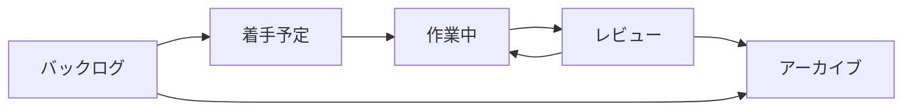

# チケット作成ルール 全文（§0〜§10）

チケット作成ルールの詳細版。[SKILL.md](SKILL.md) の要点と合わせて使う。

## 設定（この文書が使う固有名詞）

| プレースホルダ | 意味 | 例 |
|---|---|---|
| {対象プロダクト} | チケットの対象となるプロダクト名 | 例）XXアプリ |
| {対象DB名} | 起票先DBの名前 | {対象プロダクト} 開発チケット |
| {データソースID} | 起票先DBのデータソースURL | collection://xxxxxxxx-xxxx-... |
| {依頼元} | 要望・不具合報告を出す側 | 企画部 |
| {開発チーム} | 実際に作る側 | 開発チーム |
| {IDプレフィックス} | チケットIDの接頭辞 | ABC |

## 0. 対象と前提
対象DB：{対象DB名}
データソースID：{データソースID}
表記：依頼元は {依頼元}、開発者は {開発チーム} と表記を統一する（他の呼び方は使わない）
起票対象：{対象プロダクト} の開発に関する{依頼元}からの要望・不具合報告・確認事項、および{開発チーム}起因の改善
起票者：人・AIエージェントのどちらも同じルールに従う（差分を出さないことが目的）

## 1. 起票フロー
情報源を読む：{依頼元}とのMTG議事録・チャット・メールを読み、要望を1件ずつ抜き出す。
重複チェック：DBをキーワード・機能領域で検索し、同じ要件のチケットがあれば新規作成せず、既存チケットの「更新ログ」「未確定事項」に追記する。
分割判断：「2. 粒度・分割ルール」に従って1チケットの範囲を決める。
プロパティ設定：「4. プロパティ規定」に従ってすべての必須項目を埋める。
本文記入：「6. 本文テンプレート」をそのまま使い、見出しを削除・改名しない。
未確定事項の扱い：分からないことは推測で埋めず「未確定事項・質問」に書く。未確定事項が残っている間は「バックログ」から動かさない。
報告：作成・更新したチケットを {IDプレフィックス}-番号｜チケット名｜ステータス の一覧で依頼者に返す。

## 2. 粒度・分割ルール
1チケット ＝ {依頼元}が受入確認で「できた／できていない」を判定できる成果1つ。
1つのメッセージに複数の要望がある場合は、要望ごとに別チケットにする。
見積工数が16hを超えそうなもの、または受入条件が6個以上になるものは分割する。まとめ役の親チケット（種別は主な内容に合わせる）を作り、子チケットを「親チケット」でつなぐ。
不具合修正と仕様変更を1チケットに混ぜない。
開発作業を伴わない質問・確認だけのものは種別「確認事項」で起票する。
あるチケットが終わらないと着手できないものは「ブロック元」に前提チケットを設定する。

## 3. チケット名の命名規則
形式：{機能領域}：{対象}を{動詞}する

40文字以内。文末は動詞（〜する／〜できるようにする／〜を修正する）。
「〜の件」「〜対応」「〜について」「修正依頼」などの曖昧な語で終えない。
チケットID・日付・会社名・担当者名は入れない（プロパティで管理する）。
機能領域が2つにまたがる場合は主な方を1つだけ書く。

| ✅ 良い例 | ❌ 悪い例 |
|---|---|
| 商品管理：商品バリアントをCSVで一括登録できるようにする | CSVの件 |
| 注文・決済：決済失敗時に在庫が戻らない不具合を修正する | 【至急】在庫バグ対応（9/29 {依頼元}様より） |
| 管理画面：注文一覧に発送ステータスの絞り込みを追加する | 管理画面改善について |

## 4. プロパティ規定
**共通ルール：選択肢は既存のものだけを使う。新しい選択肢の追加・表記ゆれ（例：「決済」「注文決済」）は禁止。**該当がない場合は「その他」を選び、本文の更新ログに「選択肢追加の提案：○○」と書いて{開発チーム}の担当者に判断を委ねる。

| プロパティ | 必須 | 設定ルール | AIが設定してよいか |
|---|---|---|---|
| チケット名 | 必須 | 「3. 命名規則」に従う | ○ |
| チケットID | 自動 | 自動採番（{IDプレフィックス}-番号）。参照・報告時はこの形式で書く | 触らない |
| ステータス | 必須 | 新規起票時は必ず「バックログ」。遷移は「5. ステータス定義」参照 | 起票時のバックログのみ○／変更は人の指示時のみ |
| 種別 | 必須 | 1つだけ。下の「種別の定義」参照 | ○ |
| 優先度 | 必須 | 下の「優先度の基準」参照。判断できなければ「通常」 | ○（最優先は基準に該当する場合のみ） |
| 機能領域 | 必須 | 1〜2個。3個以上になるなら分割を検討 | ○ |
| 要件の出所 | 必須 | 要件が最初に出た場所（{依頼元}（MTG）／{依頼元}（チャット・メール）／{開発チーム}）。AIが自発的に見つけた改善は「AIエージェント提案」 | ○ |
| 要件ソースURL | 必須 | 元メッセージ・議事録のURL。URLがない場合は空欄にし、本文「背景・目的」に出典（日時・発言者・媒体）を書く | ○ |
| 受付日 | 必須 | 要件を受け取った日（起票日ではない） | ○ |
| 期日 | 任意 | {依頼元}と合意した納期のみ。希望日・推測日は入れず本文に書く | 合意が明記されている場合のみ |
| 見積工数(h) | 任意 | {開発チーム}の開発担当者が時間単位で入力 | ×（空欄のまま） |
| 担当者 | 任意 | 着手予定に移す時点で必須 | 人の指示がある場合のみ |
| 受入条件合意 | 必須（初期OFF） | 受入条件について{依頼元}の承認を得た時点でON | ×（人がONにする） |
| 起票者区分 | 必須 | AIが作成した場合は必ず「AIエージェント」 | ○ |
| 親チケット／子チケット | 条件付き | 分割したときに設定（片方を設定すれば逆側は自動） | ○ |
| ブロック元／ブロック先 | 条件付き | 前提となるチケットがあるときに設定 | ○ |

### 種別の定義
| 種別 | 使う場面 |
|---|---|
| 新機能 | 今までできなかったことをできるようにする |
| 改修 | 既存機能の仕様・見た目・動作を変える（仕様どおり動いているが変えたい） |
| 不具合 | 仕様どおりに動いていない。本文に再現手順を必ず書く |
| 調査 | 原因調査・技術検証・見積のための調査。成果物は調査結果の報告 |
| データ・運用 | データ移行・一括更新・設定変更など、コード変更を伴わない作業 |
| 確認事項 | 開発作業を伴わない質問・仕様確認 |

### 優先度の基準
| 優先度 | 基準（1つでも当てはまればその優先度） |
|---|---|
| 最優先 | 本番障害／売上・決済・個人情報に影響／{依頼元}から「至急」「今日中」と依頼があった |
| 高 | 合意済み期日まで2週間以内／他チケットをブロックしている／{依頼元}から優先の指定がある |
| 通常 | 上記以外の通常の要望（迷ったらこれ） |
| 低 | 「いつか」「余裕があれば」の要望、AIや{開発チーム}からの改善提案 |

## 5. ステータス定義と遷移条件
| ステータス | 意味 | この状態に入る条件 | 動かす人 |
|---|---|---|---|
| バックログ | 起票済み・未着手（要件整理中・仕様確認中を含む） | 新規起票時は必ずここ | AI／人 |
| 着手予定 | 要件確定・次に着手する | 未確定事項が0件、受入条件が書かれている、担当者と期日が入っている | {開発チーム} |
| 作業中 | 実装・作業中 | 担当者が着手した | {開発チーム} |
| レビュー | {開発チーム}内レビュー・{依頼元}の受入確認中 | 作業が終わり、確認を依頼した（確認で差し戻しがあれば「作業中」に戻す） | {開発チーム} |
| アーカイブ | 完了、または中止 | 完了：{依頼元}の受入確認OKかつ本番反映済み／中止：やらないと決まった。どちらも「更新ログ」に完了・中止の旨と理由を書く | {開発チーム}（AIは提案のみ） |



## 6. 本文テンプレート
以下をそのまま本文に貼り、各見出しの下を埋める。**見出しの削除・改名・順番の入れ替えは禁止。**書くことがない見出しには「なし」と書く。

```
## 背景・目的
（なぜ必要か。{依頼元}からの要望は要約し、重要な原文は > で引用する）

## 要件
-

## 受入条件
- [ ] 〇〇の場合、〇〇となること

## 対象外（スコープ外）
-

## 未確定事項・質問
- [ ] Q1：〇〇ですか？（確認先：{依頼元}／回答期限：YYYY-MM-DD）

## 参考資料
-

## 更新ログ
- YYYY-MM-DD 起票（起票者：AIエージェント／人の名前）
```

種別が「不具合」の場合は、「要件」の代わりに次の4見出しを入れる。

```
## 再現手順
1.
## 期待される結果
## 実際の結果
## 発生環境
（本番／ステージング、端末・ブラウザ、発生日時、該当データのID）
```

### 書き方のルール
受入条件は第三者がテストできる形で書く。「使いやすくする」「速くする」などの曖昧な表現は禁止（例：「一覧表示が3秒以内に完了すること」）。
推測を事実として書かない。推測を書く場合は文頭に「（推測）」と付ける。
{依頼元}との合意内容・金額・納期は原文を引用し、出典を添える。
未確定事項は1項目1質問。{依頼元}にそのまま送れる文章で書く。
回答が得られたら、その項目にチェックを付け、下に「→ 回答（YYYY-MM-DD）：〇〇」と追記する。

## 7. 更新ルール
要件が変わったら本文を最新の内容に書き換え、「更新ログ」に日付・変更内容・根拠（URL）を追記する。
チケットは削除しない。不要になったら「アーカイブ」にして中止の理由を書く（人の判断）。
未確定事項がすべて解消したら、更新ログに「要件確定」と書き、{開発チーム}の担当者に「着手予定」へ移せる状態になったことを報告する。
同じ要件の重複チケットを見つけたら、古い方を正とし、新しい方の内容を古い方へ移したうえで{開発チーム}の担当者に報告する（AIは統合・中止を独断しない）。

## 8. AIエージェントの禁止事項
選択肢の新規追加、プロパティの追加・削除・名称変更。
期日・見積工数・担当者・受入条件合意を推測で入力すること。
起票時の「バックログ」設定以外のステータス変更（人の明示的な指示がある場合を除く）。
チケットの削除、他人が書いた本文の削除。
{依頼元}への直接の連絡（質問文はチケットに書き、送付は{開発チーム}の担当者が行う）。

## 9. 記入例
例：チャットで届いた要望を起票した場合

**プロパティ**

チケット名：商品管理：商品バリアントをCSVで一括登録できるようにする
ステータス：バックログ／種別：新機能／優先度：通常
機能領域：商品管理、管理画面／要件の出所：{依頼元}（チャット・メール）
要件ソースURL：（該当メッセージのURL）／受付日：2026-09-29
期日・見積工数・担当者：空欄／受入条件合意：OFF／起票者区分：AIエージェント

**本文**

```
## 背景・目的
新商品の登録を1件ずつ手作業で行っており、入荷のたびに時間がかかっている。
> 毎回100件近く手で入れているので、CSVでまとめて入れられるようにしたい

## 要件
- 管理画面からCSVファイルをアップロードして商品・バリアントを一括登録できる
- 取り込み前にエラー行を画面で確認できる

## 受入条件
- [ ] 指定フォーマットのCSV（500行）を取り込むと、全行が商品・バリアントとして登録されること
- [ ] 必須項目が空の行はエラーとして行番号付きで表示され、登録されないこと

## 対象外（スコープ外）
- 既存商品の一括更新（別チケットで検討）

## 未確定事項・質問
- [ ] Q1：同じSKUが既に存在する場合は、上書きとスキップのどちらにしますか？（確認先：{依頼元}／回答期限：2026-10-03）

## 参考資料
- なし

## 更新ログ
- 2026-09-29 起票（起票者：AIエージェント）
```

## 10. 起票前チェックリスト（AIは作成前に全項目を自己確認する）
- [ ] 同じ要件のチケットが既にないか検索した
- [ ] 1チケット＝1成果になっている（複数要望を混ぜていない）
- [ ] チケット名が命名規則どおり（40字以内・動詞で終わる・曖昧語なし）
- [ ] 必須プロパティがすべて埋まっている
- [ ] 既存の選択肢だけを使っている
- [ ] 本文テンプレートの見出しをすべて残している
- [ ] 受入条件がテスト可能な形で書かれている
- [ ] 分からないことを推測で埋めず、未確定事項に書いた
- [ ] ステータスを「バックログ」にした
- [ ] 起票者区分を「AIエージェント」にした
- [ ] 依頼元は「{依頼元}」、開発者は「{開発チーム}」と表記した
